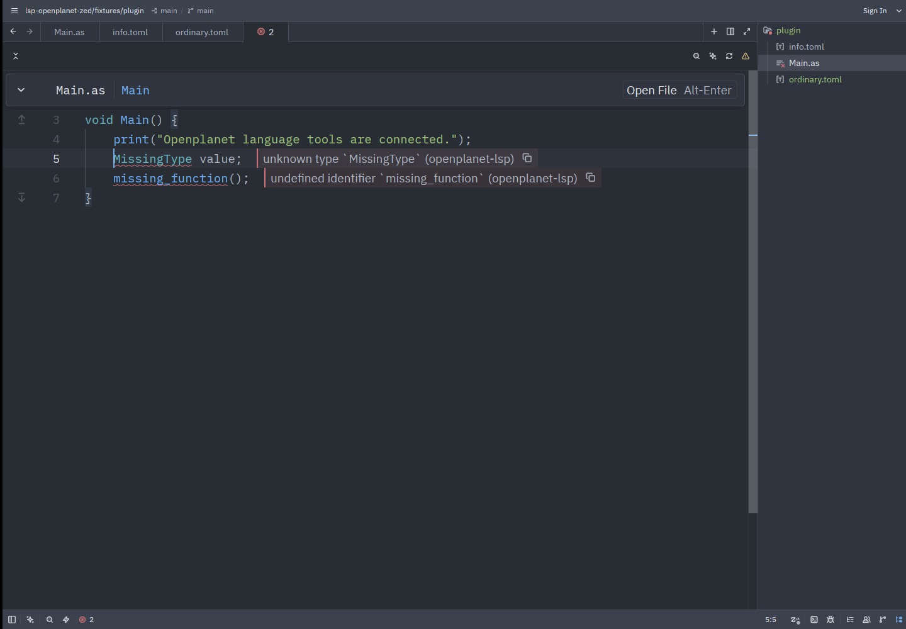

# Openplanet for Zed

Native [Zed](https://zed.dev) support for Openplanet plugin development: AngelScript highlighting, outline, indentation, and language-server diagnostics, completion, hover and navigation through [openplanet-lsp](https://github.com/clankercode/lsp-openplanet).



This is an actual Zed 1.24.2 window captured on Linux with Xvfb, showing two intentional errors in the original [smoke-test plugin](fixtures/plugin/Main.as). No diagnostics or editor UI were simulated.

## Install

Registry publication is submitted separately; see [publishing status](docs/publishing.md). Until accepted, clone this repository, install [Rust via rustup](https://rustup.rs), then run **zed: install dev extension** from Zed's command palette and choose this repository. Zed builds the Rust component and pinned Tree-sitter grammars. It downloads the current `wasm32-wasip2` Rust target and WASI SDK if needed.

Open your plugin directory, containing `info.toml` and your `.as` sources. Trust the project when Zed asks, since Restricted Mode prevents language servers from running. The server discovers `info.toml` and `.openplanet-lsp.toml`; opening the plugin root provides a predictable workspace root. Parent workspaces containing several plugin roots work through the server's normal discovery. For a single file, open its containing directory.

The extension finds `openplanet-lsp` on the workspace PATH, or downloads the latest stable official release through Zed's API. After a successful installation, a persisted cache permits a fresh session to start if the release service is unavailable. Download targets are Linux GNU, macOS, and Windows, each on x86-64 and ARM64. Only Linux x86-64 has been exercised live; the other targets have asset-mapping tests. The server always starts with `--lsp` in the extension-managed path. Alternatively install it yourself with `cargo install openplanet-lsp` or `npm install -g openplanet-lsp`.

## Configure

No initialization options are sent by default, preserving server configuration and Openplanet type-database auto-detection. Configure only explicit overrides in Zed settings:

```json
{
  "lsp": {
    "openplanet-lsp": {
      "initialization_options": {
        "openplanet_dir": "/path/to/OpenplanetNext",
        "unused": false
      }
    }
  }
}
```

The server expects snake_case keys. Its precedence is explicit initialization options, plugin `.openplanet-lsp.toml`, parent workspace config, user `~/.config/openplanet-lsp/config.toml`, then auto-detection. No fixture type database is bundled or set as a production default.

To use a particular binary, set **both** path and arguments:

```json
{
  "lsp": {
    "openplanet-lsp": {
      "binary": {
        "path": "/absolute/path/to/openplanet-lsp",
        "arguments": ["--lsp"]
      }
    }
  }
}
```

Zed applies this native binary override directly, including its arguments. An invalid explicit path fails visibly; it does not silently fall back. Do not omit `--lsp`. Windows paths in JSON require escaped backslashes, e.g. `"C:\\tools\\openplanet-lsp.exe"`.

`.as` files use **AngelScript**. Only a file named `info.toml` uses **Openplanet Manifest**, with TOML highlighting and the Openplanet language server. Other `.toml` files remain available to Zed's normal TOML extension. The syntax grammar is pinned upstream; Openplanet-specific syntax recovery and semantic knowledge come from the language server, so grammar highlighting is not a compiler check.

## Troubleshooting

- No diagnostics: trust the workspace, open the plugin root, and run **editor: restart language server**.
- Wrong server: inspect **zed: open log** for the binary and `--lsp` arguments. Remove an obsolete `lsp.openplanet-lsp.binary` override.
- Missing Openplanet API completions: install Openplanet or set `openplanet_dir` to the real installation. The server auto-detects known locations such as `~/OpenplanetNext`.
- Download failure or unsupported system: install the server yourself and use the explicit binary setting. Linux downloads require a GNU/glibc environment; musl is not a published target.
- `info.toml` opens as ordinary TOML: use Zed's language selector to select **Openplanet Manifest** and check other custom file associations. This extension intentionally does not own all TOML.
- Local build fails: install stable Rust via rustup and `rustup target add wasm32-wasip2`. Zed also needs a working network and WASI SDK for grammars.

## Development and evidence

```sh
cargo fmt --all -- --check
cargo test --locked -j 2
cargo clippy --locked --all-targets -j 2 -- -D warnings
cargo build --locked --release --target wasm32-wasip2 -j 2
```

See [verification](docs/verification.md) for exact live checks, known limits, and screenshot provenance; [publishing](docs/publishing.md) for the registry process. Grammar tests compile every AngelScript query against its pinned parser, parse generalized references/handles and the plugin sample, and check TOML queries and exact manifest association. The two native Tree-sitter runtime versions run in separate test executables.

## License

Original extension code, documentation and fixtures are available under **Unlicense OR CC0-1.0**, at your choice. Full texts: [Unlicense](UNLICENSE), [CC0](LICENSE-CC0); [LICENSE](LICENSE) repeats the Unlicense for registry detection.

The pinned AngelScript grammar and adapted highlighting queries are by Valeryi Savich, under [BSD-3-Clause](docs/grammar-LICENSE-BSD-3-Clause). The pinned TOML grammar is by Ika and contributors under [MIT](docs/toml-LICENSE-MIT). Those upstream terms continue to apply. The complete first-party and upstream notices are also bundled in [`languages/LICENSES`](languages/LICENSES), which is included in native Zed registry packages. The Rust Zed API dependency is Apache-2.0; dependencies retain their own licenses.
